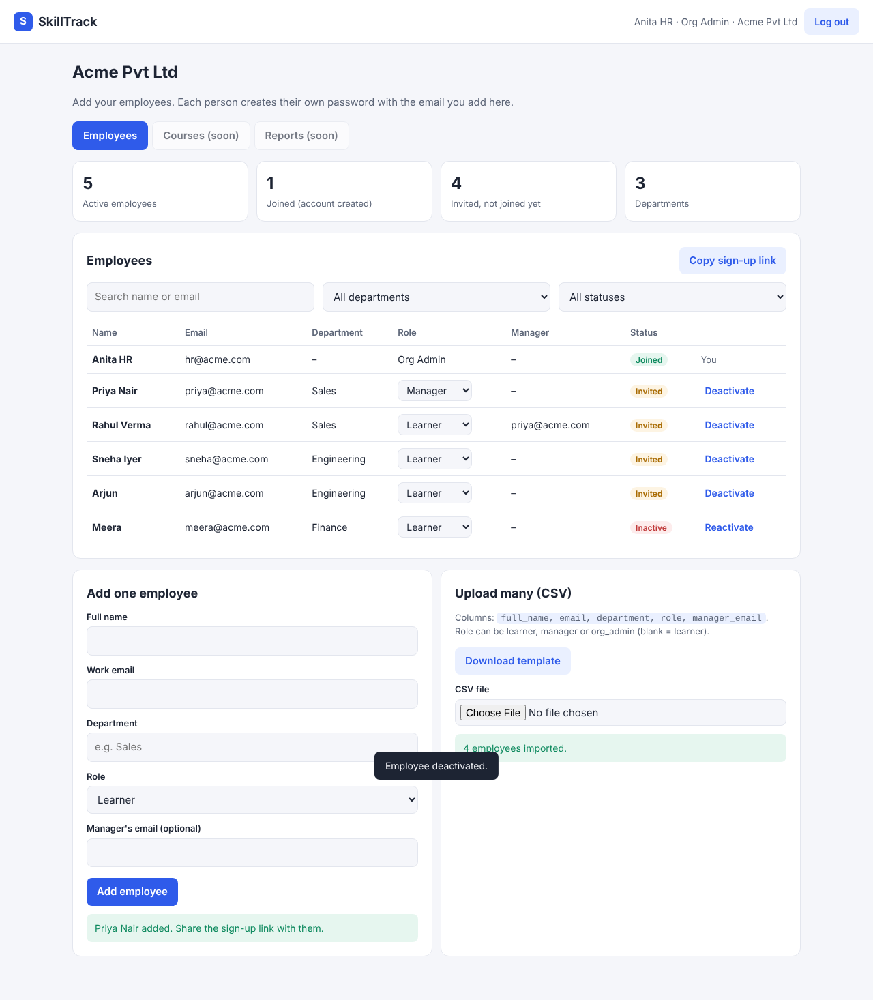
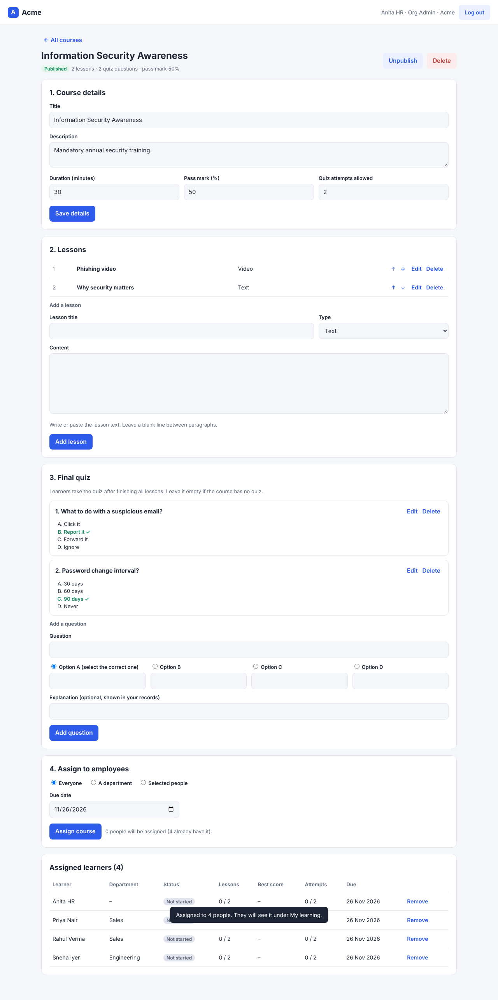
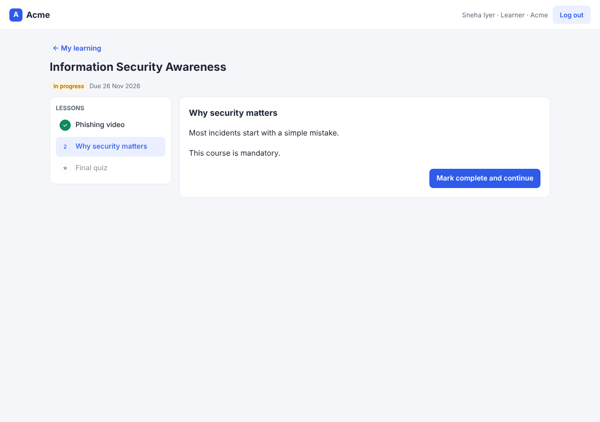
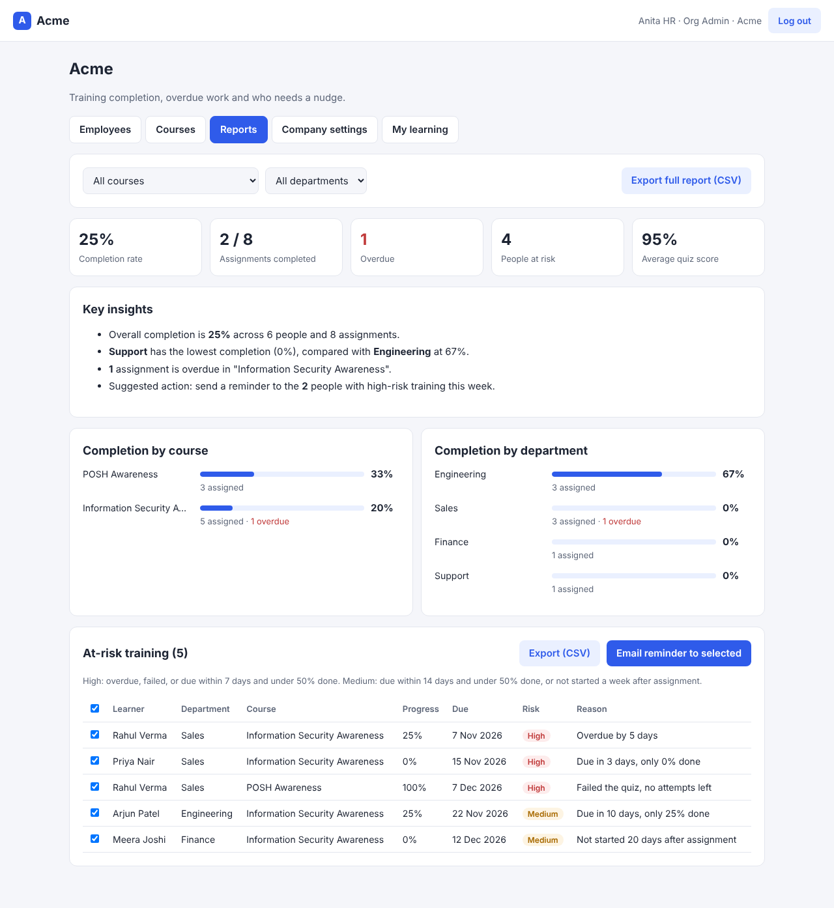

# SkillTrack

Simple training and compliance tracking for growing companies: assign mandatory training, track completion against deadlines, and prove compliance.

## Week 1 features (live)
- Login, sign-up and password reset (Supabase Auth)
- Four roles: **Super Admin** (SkillTrack owner), **Org Admin** (company HR), **Manager**, **Learner**
- Super Admin creates client companies and their first HR admin, with user limits and pause/activate
- HR adds employees one by one or by **CSV upload**, with row-by-row validation
- Employee list with search, department and status filters, role changes, deactivate/reactivate
- Only invited emails can create an account
- Each company's data is isolated by database security rules (Row Level Security)

## Week 2 features (live)
- **Course builder** for HR: details, pass mark, quiz attempts, lessons (text, YouTube/Vimeo video, PDF link) with reordering, and a multiple-choice final quiz
- Publish / unpublish, delete
- **Assign** a course to everyone, a department or selected people, with a due date
- **Assigned learners** table: status (including Overdue), lesson progress, best score, attempts, reset attempts, remove
- **My learning** for every employee: to-do and completed courses, progress bars, due dates
- **Course player**: lessons in order, then the quiz; quiz is graded on the server so answers are never sent to the browser
- **Certificate of completion** (print or save as PDF) with a unique certificate number
- **Manager view** of their team's training

## Week 4 features (live)
- **Reports** tab for HR: completion rate, overdue count, people at risk, average score
- Completion by course and by department, filterable
- **At-risk list** with a plain-English reason (overdue, failed, due soon with little progress, not started)
- **Email reminder** button: opens HR's email app with the selected learners in BCC and a ready message
- Export the full report or the at-risk list to CSV
- More reliable PDF lessons, and tighter database permissions

## Week 5 features (live)
- **Create a course with AI**: HR types a topic (and optionally pastes their own policy), picks audience, level, number of lessons and questions
- Claude drafts the lessons and the quiz as structured data; with source material it uses only that content
- **No API key yet?** "Use a free AI chat" gives HR a ready prompt to paste into any AI chat (e.g. the claude.ai free plan) and reads the answer back in, with the same checks
- HR reviews a preview, then saves it as a **draft** course to edit and publish (nothing is published automatically)
- Runs in a Supabase Edge Function (`supabase/functions/ai-course`), so the AI key never reaches the browser, and only HR admins can use it

## Week 6 features (live)
- **Admin-created logins**: when HR adds an employee (one by one, CSV, or a new company's HR admin), SkillTrack can create the login straight away
- A **temporary password** is generated, shown to the admin **once** with a Copy button (and Copy all / Download CSV for bulk), and emailed in a **welcome email** with the login page, email and password
- **Reset password** for any employee: a new temporary password, shown once and emailed
- Employees must **choose their own password at first login**
- Passwords are never stored in a readable form; logins are managed by a Supabase Edge Function (`supabase/functions/manage-users`) that checks the caller is HR admin of that company

## Week 7 features (live)
- **File uploads**: HR can upload PDF and MP4/WebM files (up to 50 MB) as lessons, as well as paste links
- Files are **private**: stored per company, and learners open them through links that expire after an hour
- **Company branding**: each company gets its own **login link** (`?company=<name>`) with its logo, name and colour
- **Company settings** tab: copy the login link, upload a logo, choose a brand colour
- The logo and colour appear in the header, on the login page, in welcome emails and on **certificates**

Coming next: automatic training reminder emails.

## One-time setup

### 1. Database (Supabase)
1. Open your Supabase project → **SQL Editor** → **New query**.
2. Open `setup.sql`, find `YOUR_EMAIL_HERE` at the bottom and replace it with **your** email (this becomes the Super Admin).
3. Paste the whole file into the editor and click **Run**. You should see "Success. No rows returned".
4. Then open a **New query**, paste the whole of `week2.sql` and click **Run**. Do the same with `week4.sql`, then `week6.sql`, then `week7.sql`.

### 2. Login settings (Supabase)
1. **Authentication → URL Configuration**
   - Site URL: `https://sachin-0915.github.io/skilltrack/`
   - Redirect URLs: add the same address.
2. Supabase's built-in email sends only a few emails per hour. That is fine for testing. Before real clients, connect a proper email service (planned for Week 4).

### 3. AI course generator (optional)
1. Create an API key at console.anthropic.com (add a little credit first).
2. Supabase → **Edge Functions → Secrets** → add `ANTHROPIC_API_KEY` with that key.
3. Supabase → **Edge Functions → Deploy a new function → Via Editor**, name it `ai-course`, paste `supabase/functions/ai-course/index.ts`, Deploy.

### 3b. Logins and welcome emails
1. Run `week6.sql` in the SQL Editor.
2. Supabase → **Edge Functions → Deploy a new function → Via Editor**, name it `manage-users`, paste `supabase/functions/manage-users/index.ts`, Deploy.
3. Optional, for emails: create a free Brevo account, verify your sender email, create an API key, and add the secrets `BREVO_API_KEY`, `SENDER_EMAIL` (and optionally `SENDER_NAME`).

### 3c. File uploads and branding
1. Run `week7.sql` in the SQL Editor (creates the storage buckets and their security rules).
2. Re-deploy `manage-users` with the updated file (welcome emails now use each company's login link and logo).

### 4. Connect the app
Open `config.js` and paste your **Project URL** and **anon public** key from Supabase → Project Settings → API.
Never paste the `service_role` key anywhere in this project.

### 5. Publish (GitHub Pages)
1. Upload all files to the `skilltrack` repo (Add file → Upload files → drag them in → Commit changes).
2. Settings → Pages → Branch: `main`, folder `/ (root)` → Save.
3. Open `https://sachin-0915.github.io/skilltrack/`.

### 6. First login
Click **Create account** with the email you put in `setup.sql`, confirm it from your inbox, then log in. You will see the **Companies** screen.

## Test checklist
- [ ] Create a test company with yourself as the HR admin using a second email
- [ ] Log in as that HR admin, upload `sample-employees.csv`
- [ ] Try signing up with an email that was never added (it should be refused)
- [ ] Change a role, deactivate and reactivate someone
- [ ] Open the site on your phone

## Tech
Plain HTML/CSS/JavaScript (no build step) · Supabase (Postgres, Auth, Row Level Security) · GitHub Pages.

---
Built by **Sachin D** with AI-assisted development (Claude Code).
