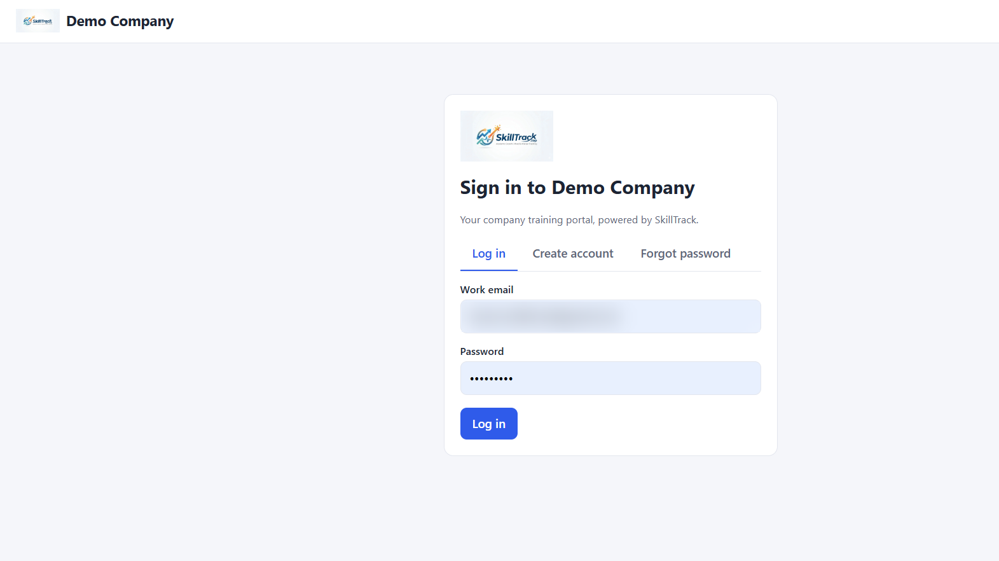
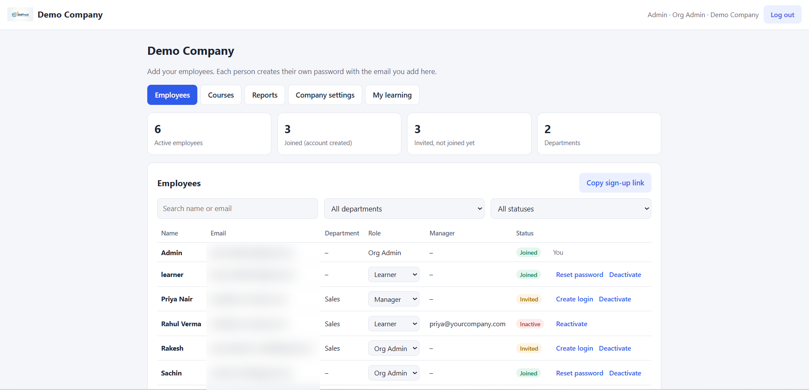
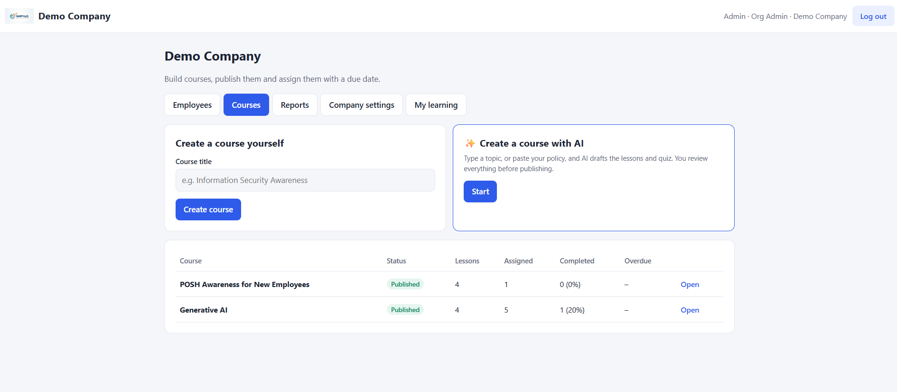
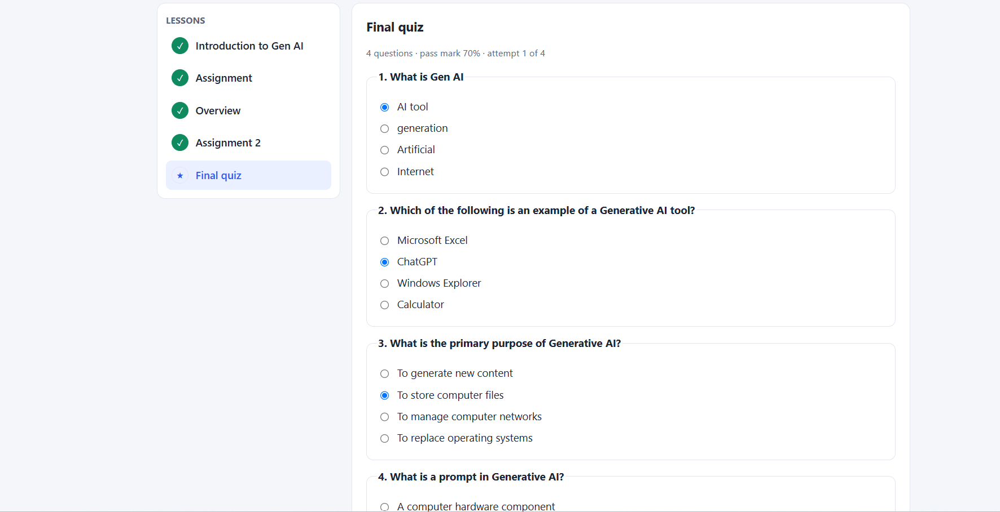
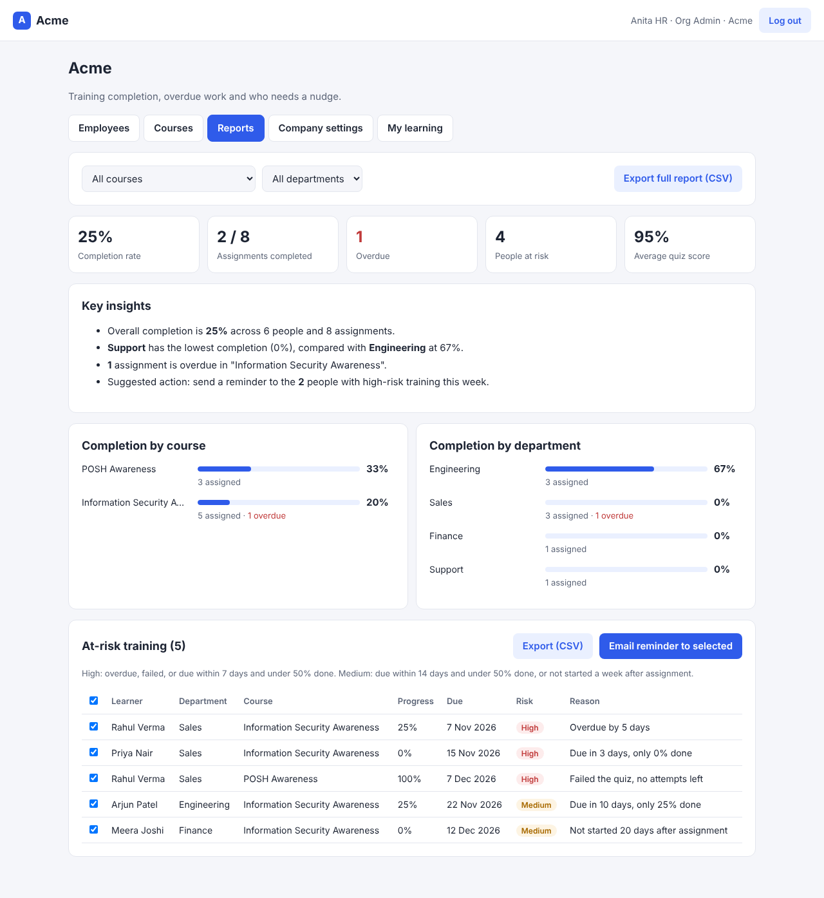
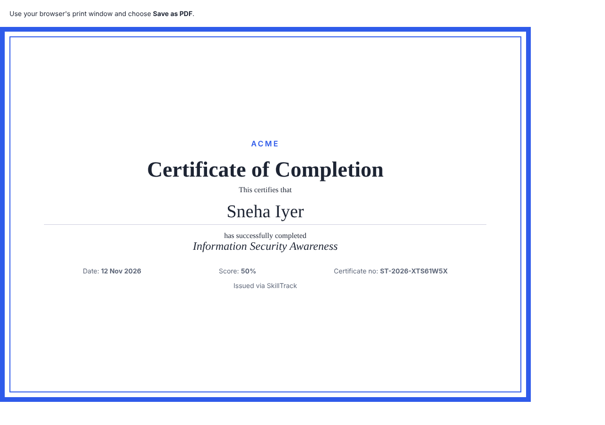
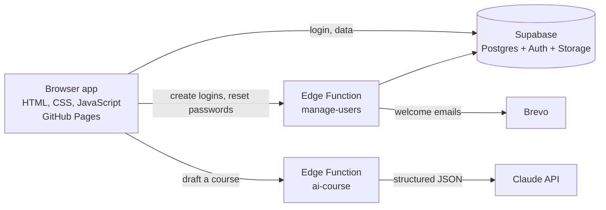

# SkillTrack

**A simple, AI-assisted LMS that helps growing companies assign mandatory training, track completion against deadlines, and prove compliance.**

**Live app:** https://sachin-0915.github.io/skilltrack/?company=demo-company (opens the branded login page; logins are created by each company's HR, so a guided demo is available on request)

## Why I built it

I have spent six years running enterprise LMS platforms: onboarding tens of thousands of learners, configuring tenants, building assessments and chasing completion reports. Small and mid-size companies have the same compliance needs (POSH, information security, onboarding) but run training on email, shared drives and Excel, because enterprise LMS tools are too expensive and complex for them.

SkillTrack is my answer: an LMS a company can set up in a day, where HR can create a course with AI in minutes and always knows who needs a nudge.

## What it does

| For | Features |
| --- | --- |
| **HR admins** | Add employees one by one or by CSV · create logins with temporary passwords, welcome emails and password resets · build courses (text, video, PDF, uploads) with a final quiz · **create a course with AI** from a topic or their own policy · assign courses to everyone, a department or selected people with a due date · reports with an **at-risk list** and reminder emails · company logo, colour and login link |
| **Learners** | My learning dashboard with due dates · course player · quiz with instant score and retries · certificate of completion · must set their own password at first login |
| **Managers** | Their team's training status |
| **SkillTrack owner** | Create client companies (tenants), set user limits, pause or activate |

### Screenshots

| | |
| --- | --- |
|  **Employees and logins** |  **Courses, with AI course creation** |
|  **Learner quiz** |  **Reports and at-risk list** |
|  **Branded certificate** | |

## How it works

- **Multi-tenant by design:** every record carries a company ID, and Postgres **Row Level Security** makes sure a company can only ever read its own employees, courses, progress and files.
- **Secure by default:** quizzes are graded in the database, so answers never reach the learner's browser; uploaded files are private and opened through links that expire; passwords are never stored in a readable form; API keys live only in server functions.
- **AI with a human in the loop:** Claude drafts lessons and quiz questions as structured data (only from the company's own policy when one is pasted); HR reviews the draft before anything is published. Without an API key, HR can use a free AI chat and paste the answer back in.
- **Tested:** every database script was run against Postgres with misuse tests (cross-company access, self-promotion, quiz cheating), and every screen was tested end to end in a headless browser.

## What I did as the product owner

- Wrote the product spec (PRD): users, goals, MVP scope, data model, business rules and the build plan
- Defined the business rules from LMS experience: assignment statuses, overdue and **at-risk** rules, quiz attempts, certificate rules, onboarding and password policy
- Prioritised and shipped weekly, tested every release on the live product, and fed bugs back into the next iteration
- Built with AI-assisted development (Claude Code): I owned the product decisions and testing; the AI wrote the code

## Roadmap

- Automatic training reminder emails (3 days before the due date and when overdue)
- Custom domain and email domain per client
- SCORM upload, learning paths and a course template library (POSH, InfoSec, Code of Conduct)
- Payments and self-serve sign-up for new companies

## Tech

Plain HTML, CSS and JavaScript (no build step) · Supabase (Postgres, Auth, Row Level Security, Storage, Edge Functions) · Claude API · Brevo · GitHub Pages

Want to run your own copy? See the [setup guide](SETUP.md).

---
Built by **Sachin D**, product specialist with 6+ years in LMS and EdTech · [LinkedIn](https://www.linkedin.com/in/sachin-d-aa1583256/)
